<p align="center">
  
</p>

<p align="center">
  
  
  
  
  
  
</p>

<p align="center">
  <b>A hands-on demonstration of the Java cold-start problem in AWS Lambda,<br>
  and how SnapStart reduces it by restoring a pre-initialized snapshot.</b>
</p>

---

## ⚡ Result at a glance

| | Without SnapStart | With SnapStart | Change |
|---|:---:|:---:|:---:|
| **Startup phase** (CloudWatch) | `Init Duration` **3347.04 ms** | `Restore Duration` **549.09 ms** | 🟢 **−2797.95 ms (83.6%)** |
| Handler `Duration` | 10.49 ms | 48.39 ms | first run after restore |
| **Total time before response** | ≈ 3357.5 ms | ≈ 597.5 ms | 🟢 **≈ 5.6× faster** |
| Version invoked | `$LATEST` | `Version 4` | |

<p align="center">
  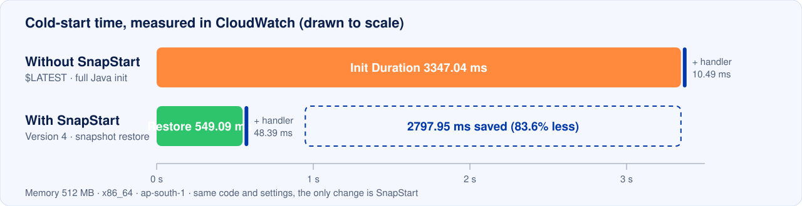
</p>

---

## 📑 Table of contents

1. [Project Overview](#1-project-overview)
2. [Problem Statement](#2-problem-statement)
3. [What is AWS Lambda SnapStart?](#3-what-is-aws-lambda-snapstart)
4. [Project Objectives](#4-project-objectives)
5. [Technologies Used](#5-technologies-used)
6. [System Architecture and Workflow](#6-system-architecture-and-workflow)
7. [AWS Lambda Configuration](#7-aws-lambda-configuration)
8. [Java Lambda Function and Testing](#8-java-lambda-function-and-testing)
9. [Cold Start and Initialization (without SnapStart)](#9-cold-start-and-initialization-without-snapstart)
10. [SnapStart Snapshot and Restore (with SnapStart)](#10-snapstart-snapshot-and-restore-with-snapstart)
11. [CloudWatch Monitoring and Observations](#11-cloudwatch-monitoring-and-observations)
12. [Without SnapStart vs With SnapStart](#12-without-snapstart-vs-with-snapstart)
13. [Project Structure and Screenshots](#13-project-structure-and-screenshots)
14. [Conclusion and Key Learning](#14-conclusion-and-key-learning)

---

## 1. Project Overview

This project demonstrates **AWS Lambda SnapStart** using **Java 21**.

The goal is to understand the **Java cold start problem** in AWS Lambda and show, with real CloudWatch logs, how SnapStart uses a **pre-initialized snapshot** to avoid repeating initialization work.

> [!NOTE]
> Everything was built and tested from the **AWS Management Console**, using **Java 21**, **Maven**, **AWS Lambda** and **Amazon CloudWatch**.

---

## 2. Problem Statement

> **Our problem is Java cold start in AWS Lambda.**
> When there is no ready environment, Lambda has to create an environment and initialize Java before it can run our code. This takes time and can **delay the first response**. Our project uses **AWS Lambda SnapStart** to reduce this startup delay.

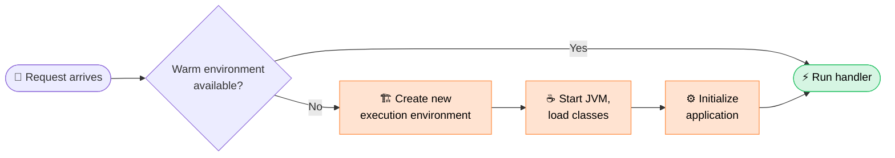

The orange steps are the **cold start**. The user is waiting during all of them, before any of our business logic runs.

### 🧑‍💻 Real-life example: Tatkal ticket booking at 10:00 AM

Thousands of users tap **"Book Now"** in the same second. Lambda scales out by creating many new environments, and **every new environment is a cold start**.

| ⏱️ | 🔴 Without SnapStart | 🟢 With SnapStart |
|---|---|---|
| 0.0 s | User taps "Pay & Book" | User taps "Pay & Book" |
| Startup | JVM starts, classes load, app initializes: **≈ 3.3 s** of spinner | Lambda restores the ready snapshot: **≈ 0.55 s** |
| Meanwhile | Impatient user taps again → duplicate request, more cold starts | Handler runs straight away |
| Outcome | Slow first response, the seat may already be gone | Fast, predictable first response |

> [!TIP]
> **Simple analogy:** a laptop that is **shut down** takes a long time to start, because the OS and apps must load again. A laptop in **sleep mode** is ready almost instantly. SnapStart is like waking from sleep: it restores an environment that was already initialized.

---

## 3. What is AWS Lambda SnapStart?

**AWS Lambda SnapStart** improves startup performance by doing the expensive initialization **once**, when you publish a version, instead of on every cold start.

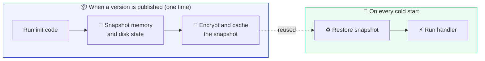

Instead of repeating the complete Java startup, Lambda **resumes from the initialized state** saved in the snapshot.

> [!IMPORTANT]
> SnapStart works on **published versions** (for example `SNAPSTART:4`), not on `$LATEST`. That is why the setting is called `PublishedVersions`.

---

## 4. Project Objectives

| # | Objective | Status |
|:-:|---|:-:|
| 1 | Understand Java cold starts | ✅ |
| 2 | Create a Java Lambda function on the **Java 21** runtime | ✅ |
| 3 | Observe Lambda **initialization** in CloudWatch | ✅ |
| 4 | Enable **SnapStart** (`PublishedVersions`) | ✅ |
| 5 | **Publish** a Lambda version and invoke it | ✅ |
| 6 | Observe the **restore** process | ✅ |
| 7 | Analyze CloudWatch logs: **initialization vs restore** | ✅ |

---

## 5. Technologies Used

| Technology | Purpose |
|---|---|
|  | Serverless function execution |
|  | Snapshot-based startup optimization |
|  | Lambda runtime |
|  | Build and package the Lambda JAR |
|  | Monitoring and log analysis |
|  | Configuration and testing |
|  | Source code and documentation |

---

## 6. System Architecture and Workflow

### 🏛️ Architecture

<p align="center">
  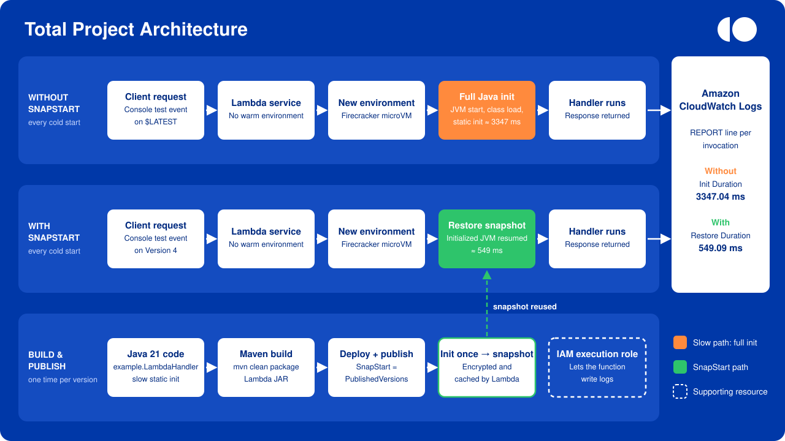
</p>

| Lane | What happens |
|---|---|
| 🛠️ **Build & publish** (one time) | Maven packages the Java 21 code → we publish a version with SnapStart on → Lambda runs init **once** and stores an encrypted snapshot |
| 🔴 **Without SnapStart** | Every new environment repeats the **full Java init** before the handler can run |
| 🟢 **With SnapStart** | Every new environment **restores the snapshot** and goes straight to the handler |
| 📊 **CloudWatch Logs** | Records `Init Duration` and `Restore Duration` so we can compare the two paths |

The two cold-start lanes are identical except for one step: **full Java init** (orange) vs **restore snapshot** (green).

### 🔄 Complete workflow

| Step | Action | Evidence |
|:-:|---|---|
| 1️⃣ | Create the Lambda function `SNAPSTART` | [📸 01](#7-aws-lambda-configuration) |
| 2️⃣ | Configure the **Java 21** runtime and handler | [📸 02](#7-aws-lambda-configuration) |
| 3️⃣ | Build with Maven and upload the JAR (SnapStart still `None`) | [📸 03](#7-aws-lambda-configuration) |
| 4️⃣ | Create a test event and invoke `$LATEST` | [📸 04 · 05](#8-java-lambda-function-and-testing) |
| 5️⃣ | Observe **initialization** in CloudWatch: `Init Duration` | [📸 06](#9-cold-start-and-initialization-without-snapstart) |
| 6️⃣ | Enable **SnapStart** → `PublishedVersions` | [📸 07](#10-snapstart-snapshot-and-restore-with-snapstart) |
| 7️⃣ | **Publish** a new version (Version 4) | [📸 08](#10-snapstart-snapshot-and-restore-with-snapstart) |
| 8️⃣ | Invoke **Version 4** | [📸 09](#10-snapstart-snapshot-and-restore-with-snapstart) |
| 9️⃣ | Observe **restore** in CloudWatch: `Restore Duration` | [📸 10](#10-snapstart-snapshot-and-restore-with-snapstart) |
| 🔟 | Compare initialization vs restore | [Section 12](#12-without-snapstart-vs-with-snapstart) |

---

## 7. AWS Lambda Configuration

| Setting | Value |
|---|---|
| Function name | `SNAPSTART` |
| Runtime | **Java 21** |
| Handler | `example.LambdaHandler::handleRequest` |
| Architecture | `x86_64` |
| Memory | **512 MB** |
| Ephemeral storage | 512 MB |
| Timeout | **10 seconds** |
| Package | Zip (Maven JAR, 13.5 kB) |
| SnapStart | `PublishedVersions` → tested on **Version 4** |
| Region | Asia Pacific (Mumbai) `ap-south-1` |

<details open>
<summary><b>📸 Lambda function list</b>: both test functions use the Java 21 runtime</summary>
<br>
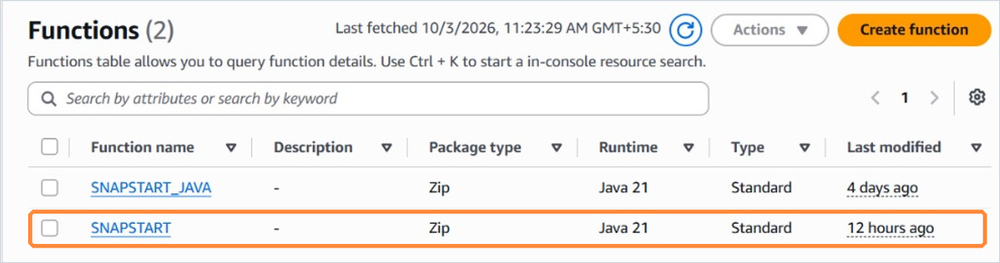
</details>

<details open>
<summary><b>📸 Runtime settings</b>: Java 21, handler <code>example.LambdaHandler::handleRequest</code>, x86_64</summary>
<br>
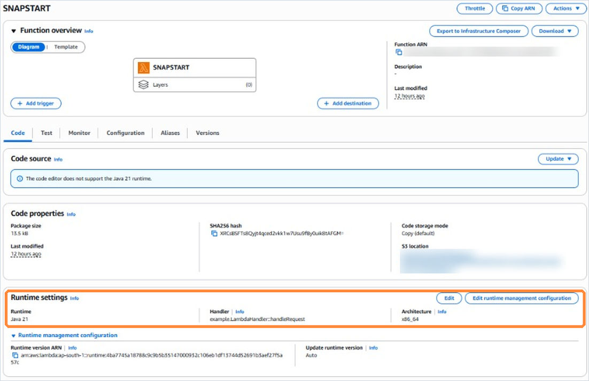
</details>

<details open>
<summary><b>📸 General configuration before SnapStart</b>: 512 MB memory, 10 s timeout, SnapStart <code>None</code></summary>
<br>
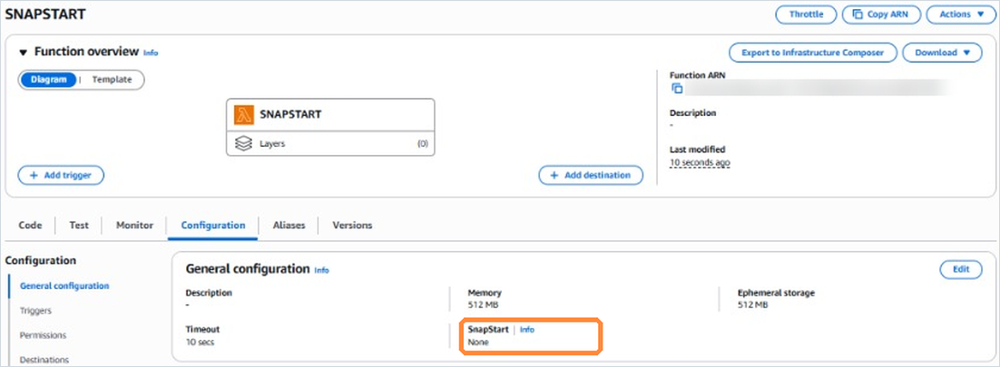
</details>

---

## 8. Java Lambda Function and Testing

The function is intentionally simple. Its **initialization phase is made deliberately slow** so the cold-start cost is easy to see in the logs. The project is about **initialization vs restore behavior**, not about business logic.

```java
package example;

import com.amazonaws.services.lambda.runtime.Context;
import com.amazonaws.services.lambda.runtime.RequestHandler;
import java.util.Map;

public class LambdaHandler implements RequestHandler<Map<String, Object>, String> {

    // Runs during the INIT phase (or once, before the snapshot, with SnapStart)
    static {
        System.out.println("===== APPLICATION INITIALIZATION STARTED =====");
        long start = System.currentTimeMillis();
        try {
            Thread.sleep(3000); // simulate heavy startup: frameworks, config, clients
        } catch (InterruptedException e) {
            Thread.currentThread().interrupt();
        }
        System.out.println("Initialization completed in " + (System.currentTimeMillis() - start) + " ms");
        System.out.println("===== APPLICATION INITIALIZATION COMPLETED =====");
    }

    @Override
    public String handleRequest(Map<String, Object> event, Context context) {
        System.out.println("===== LAMBDA HANDLER EXECUTED =====");
        System.out.println("Request ID: " + context.getAwsRequestId());
        return "Hello " + event.getOrDefault("name", "World");
    }
}
```

**Build the deployment package:**

```bash
mvn clean package
```

Upload the JAR from `target/` in **Code → Upload from → .zip or .jar file**.

### 🧪 Testing steps

1. Open the Lambda function and go to the **Test** tab.
2. Create a test event (for example `TEST0`) with this JSON:
   ```json
   { "name": "Koushik" }
   ```
3. Click **Test** and confirm `Executing function: succeeded`.
4. Open **CloudWatch Logs** from the `logs` link.

<details open>
<summary><b>📸 Test event</b>: synchronous invocation with a simple JSON event</summary>
<br>
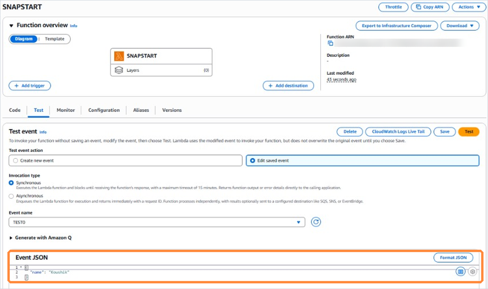
</details>

---

## 9. Cold Start and Initialization (without SnapStart)

On the **first invocation of `$LATEST`**, Lambda had no ready environment, so it went through the full cold start:

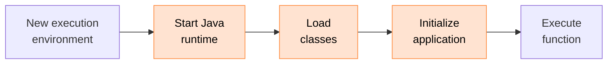

<details open>
<summary><b>📸 Test on <code>$LATEST</code></b>: executing function succeeded</summary>
<br>
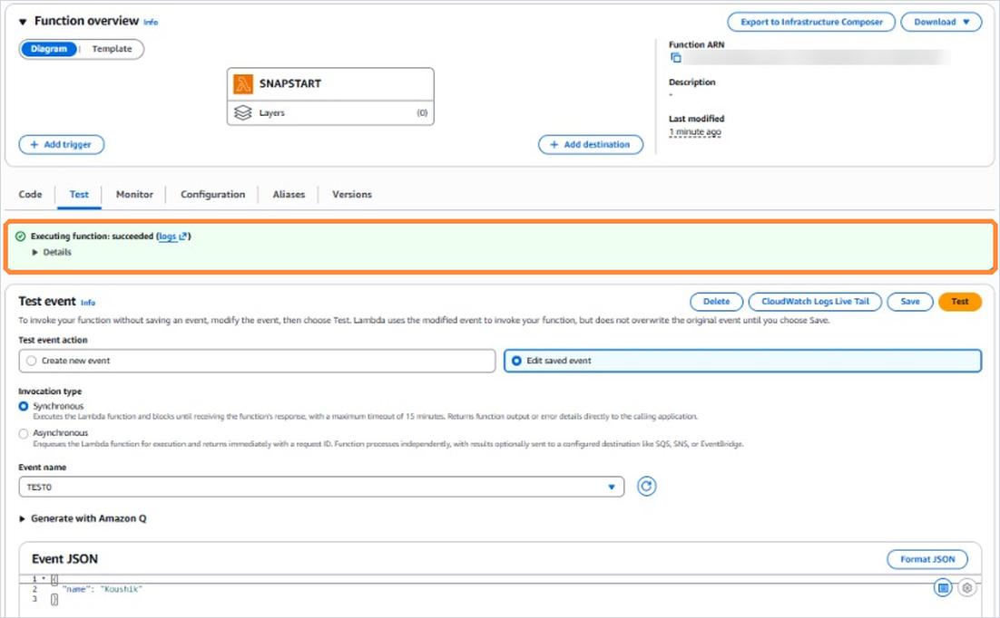
</details>

<details open>
<summary><b>📸 CloudWatch logs: initialization</b>: <code>Initialization completed in 3001 ms</code> and <code>Init Duration: 3347.04 ms</code></summary>
<br>
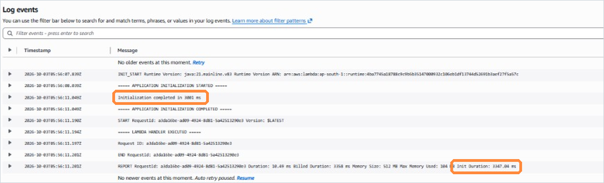
</details>

```text
INIT_START Runtime Version: java:21.mainline.v83
===== APPLICATION INITIALIZATION STARTED =====
Initialization completed in 3001 ms
===== APPLICATION INITIALIZATION COMPLETED =====
START RequestId: a3da16be-...  Version: $LATEST
===== LAMBDA HANDLER EXECUTED =====
REPORT ... Duration: 10.49 ms  Billed Duration: 3358 ms  Memory Size: 512 MB  Max Memory Used: 104 MB  Init Duration: 3347.04 ms
```

> [!WARNING]
> The handler itself took only **10.49 ms**, but the user waited **3347.04 ms** for initialization first. That is the cold-start problem in one line.

---

## 10. SnapStart Snapshot and Restore (with SnapStart)

### Step 1: Enable SnapStart

**Configuration → General configuration → Edit → SnapStart: `PublishedVersions`**

<details open>
<summary><b>📸 SnapStart enabled</b>: <code>PublishedVersions</code></summary>
<br>
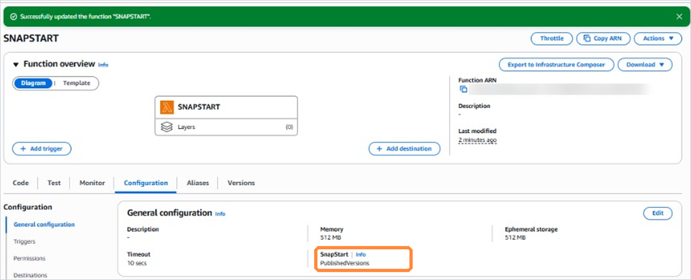
</details>

### Step 2: Publish a version

**Actions → Publish new version.** Lambda runs the initialization **once**, takes the snapshot and caches it.

<details open>
<summary><b>📸 Published Version 4</b>: SnapStart optimization status <code>On</code></summary>
<br>
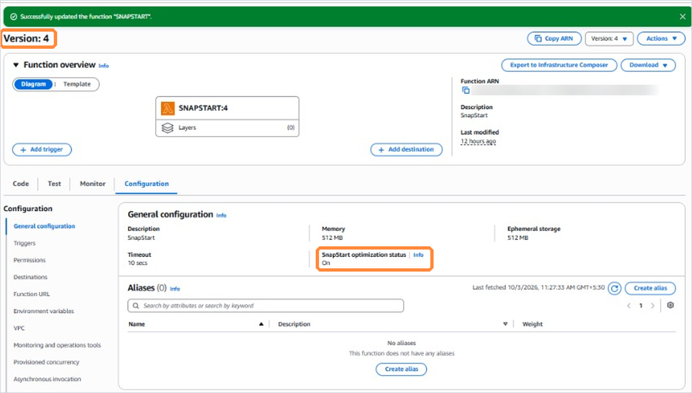
</details>

### Step 3: Invoke the published version

<details open>
<summary><b>📸 Test on Version 4</b>: executing function succeeded</summary>
<br>
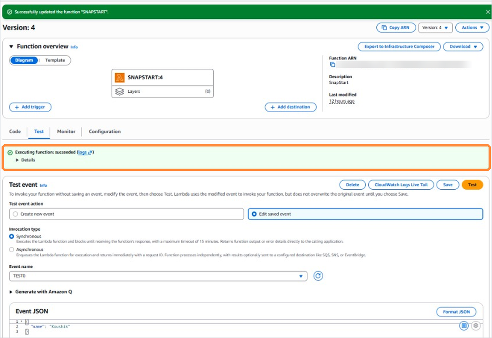
</details>

<details open>
<summary><b>📸 CloudWatch logs: restore</b>: <code>RESTORE_START</code>, <code>RESTORE_REPORT Restore Duration: 549.09 ms</code></summary>
<br>
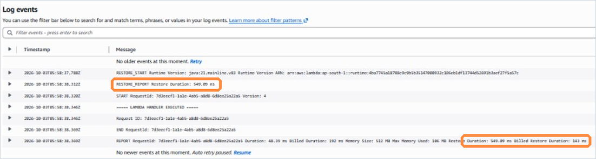
</details>

```text
RESTORE_START Runtime Version: java:21.mainline.v83
RESTORE_REPORT Restore Duration: 549.09 ms
START RequestId: 7d3eecf1-...  Version: 4
===== LAMBDA HANDLER EXECUTED =====
REPORT ... Duration: 48.39 ms  Billed Duration: 192 ms  Memory Size: 512 MB  Max Memory Used: 106 MB  Restore Duration: 549.09 ms  Billed Restore Duration: 143 ms
```

> [!NOTE]
> The `APPLICATION INITIALIZATION` lines **do not appear** here. The static initializer already ran before the snapshot was taken, so Lambda **restored** that state instead of running it again.

---

## 11. CloudWatch Monitoring and Observations

| Log entry | Seen in | What it means |
|---|---|---|
| `INIT_START` | `$LATEST` | Lambda started a fresh environment and the full Java init |
| `Initialization completed in 3001 ms` | `$LATEST` | Our deliberately slow static block ran |
| `Init Duration: 3347.04 ms` | `$LATEST` | Total init time: JVM startup, class loading and our code |
| `RESTORE_START` | Version 4 | Lambda began restoring the SnapStart snapshot |
| `RESTORE_REPORT Restore Duration: 549.09 ms` | Version 4 | Time to resume the already-initialized environment |
| `Billed Restore Duration: 143 ms` | Version 4 | Restore time shown as billed in the REPORT line |

**Overall observation**

```diff
- Initialization → creating and preparing the environment from scratch   (3347.04 ms)
+ Restore        → recovering the previously initialized state           ( 549.09 ms)
```

---

## 12. Without SnapStart vs With SnapStart

<table>
<tr>
<th width="50%">🔴 Without SnapStart</th>
<th width="50%">🟢 With SnapStart</th>
</tr>
<tr>
<td>

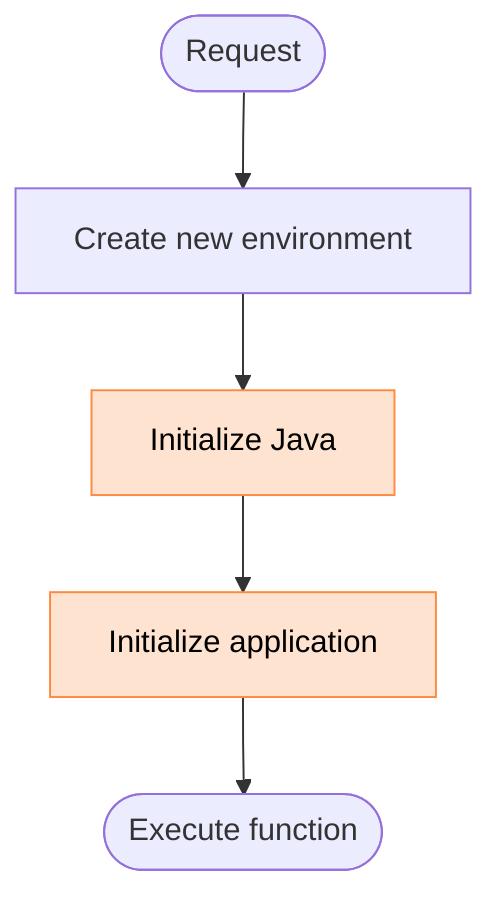

</td>
<td>

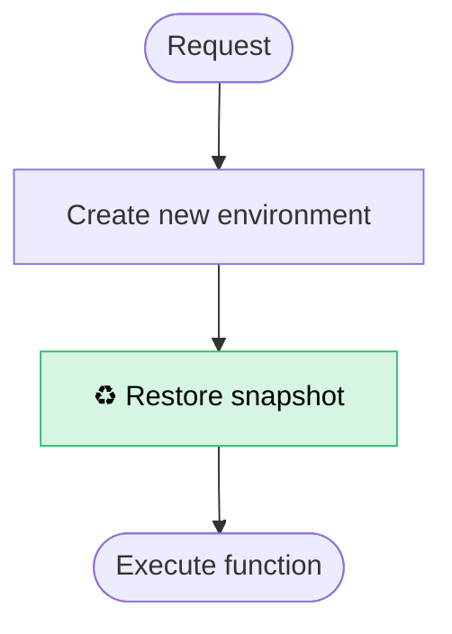

</td>
</tr>
</table>

| Aspect | 🔴 Without SnapStart | 🟢 With SnapStart |
|---|---|---|
| What happens on a cold start | Full Java initialization | Snapshot restoration |
| Startup time (measured) | **3347.04 ms** `Init Duration` | **549.09 ms** `Restore Duration` |
| Init code runs | On **every** new environment | **Once**, when the version is published |
| Snapshot | ❌ None | ✅ Encrypted, cached snapshot |
| Works on | `$LATEST` or any version | **Published versions only** |

> [!CAUTION]
> These numbers come from **our own test runs** with a deliberately slow initializer. Real improvements depend on the application, its dependencies and its configuration, so always measure.

### Things to keep in mind

- 🏷️ **Versioning discipline:** SnapStart needs published versions (or an alias that points to one).
- 🔁 **Uniqueness:** anything created during init (random seeds, unique IDs, timestamps) is **shared by every restored environment**. Generate unique values inside the handler.
- 🌐 **Connections:** network connections opened during init may be stale after a restore. Re-validate or reconnect.

---

## 13. Project Structure and Screenshots

```text
AWS-Lambda-SnapStart-Docs/
├── README.md
├── assets/
│   ├── banner.svg
│   ├── architecture.svg
│   └── results.svg
└── screenshots/
    ├── 01-lambda-functions.png
    ├── 02-runtime-settings.png
    ├── 03-config-before-snapstart.png
    ├── 04-test-event.png
    ├── 05-test-latest-success.png
    ├── 06-cloudwatch-init-logs.png
    ├── 07-snapstart-enabled.png
    ├── 08-published-version.png
    ├── 09-test-version-success.png
    └── 10-cloudwatch-restore-logs.png
```

> [!NOTE]
> The deployed Lambda JAR (`JavaSnapStartDemo-1.0.jar`) and the project presentation are in the main project repository: **[kadakoushik19/AWS-Lambda-SnapStart](https://github.com/kadakoushik19/AWS-Lambda-SnapStart)**.


| # | Screenshot | Shows | Section |
|:-:|---|---|:-:|
| 01 | `01-lambda-functions.png` | Lambda functions on Java 21 | [7](#7-aws-lambda-configuration) |
| 02 | `02-runtime-settings.png` | Runtime, handler, architecture | [7](#7-aws-lambda-configuration) |
| 03 | `03-config-before-snapstart.png` | 512 MB, 10 s, SnapStart `None` | [7](#7-aws-lambda-configuration) |
| 04 | `04-test-event.png` | Test event JSON | [8](#8-java-lambda-function-and-testing) |
| 05 | `05-test-latest-success.png` | Successful run on `$LATEST` | [9](#9-cold-start-and-initialization-without-snapstart) |
| 06 | `06-cloudwatch-init-logs.png` | `Init Duration: 3347.04 ms` | [9](#9-cold-start-and-initialization-without-snapstart) |
| 07 | `07-snapstart-enabled.png` | SnapStart `PublishedVersions` | [10](#10-snapstart-snapshot-and-restore-with-snapstart) |
| 08 | `08-published-version.png` | Version 4, optimization `On` | [10](#10-snapstart-snapshot-and-restore-with-snapstart) |
| 09 | `09-test-version-success.png` | Successful run on Version 4 | [10](#10-snapstart-snapshot-and-restore-with-snapstart) |
| 10 | `10-cloudwatch-restore-logs.png` | `Restore Duration: 549.09 ms` | [10](#10-snapstart-snapshot-and-restore-with-snapstart) |

---

## 14. Conclusion and Key Learning

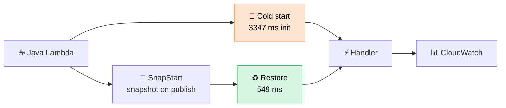

- ✅ The Java cold start in this project cost **3347.04 ms** of initialization before a **10 ms** handler could run.
- ✅ With SnapStart on a published version, startup became a **549.09 ms** restore: **83.6% less** startup time.
- ✅ **Lambda versions, SnapStart and CloudWatch logs** work together, and they make the whole lifecycle visible: `INIT_START` → `RESTORE_START` → `RESTORE_REPORT`.

> **Key learning:** SnapStart removes repeated Java initialization from the request path by restoring a previously initialized execution environment.
>
> 💻 *Cold start = starting a laptop from shutdown.* &nbsp; 😴 *SnapStart restore = waking it from sleep.*
> (This is only an analogy. Lambda restores a snapshot of an initialized microVM; it does not literally put a computer to sleep.)

---

## 👥 Team

| Name | Roll No. |
|---|---|
| N Ravindra | 2400030019 |
| M V Sai Kalyan | 2400030027 |
| Kada Koushik | 2400030046 |
| Jami Jaswanth | 2400030079 |

**Batch:** 117 &nbsp;·&nbsp; **Guided by:** Suneetha Bandeela

<p align="center"><sub>Project: <b>AWS Lambda SnapStart: Java Cold Start Demonstration</b> · Runtime: Java 21 · Platform: AWS Lambda</sub></p>
